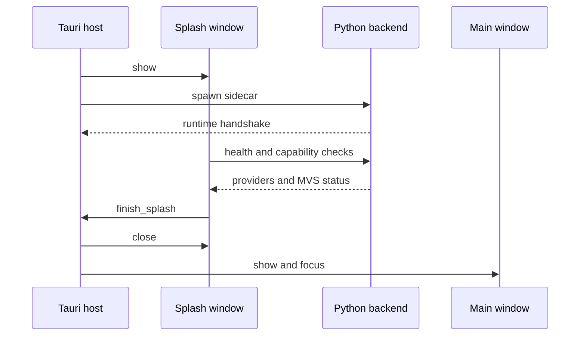

# DigiVision 桌面安装包与启动流程设计

**先完成可本机安装验证的 macOS Apple Silicon DMG，再在 Windows x64 构建机生成 NSIS 安装包。**

| | |
| --- | --- |
| **状态** | 已确认，2026-09-22 |
| **负责人** | DigiVision 开发负责人 |
| **范围** | 桌面安装包、启动窗口、运行环境检测、ONNX Runtime Provider 选择 |
| **不包含** | 正式签名证书申请、MVS SDK 再分发、Windows 构建机配置 |
| **读者** | DigiVision 开发与发布人员 |

---

## 1. 结论

DigiVision 使用一套前端和模型包，按目标平台构建两个安装器：macOS 使用 DMG，Windows 使用 NSIS Setup EXE。Python 后端、SQLite、OpenCV 和 ONNX Runtime 随应用安装。海康 MVS SDK 由用户通过官方安装包安装，DigiVision 只检测状态并给出引导。

应用启动时先显示独立 Splash 窗口。Splash 根据真实初始化结果显示后端、数据库、推理 Provider 和 MVS 状态。必要服务就绪后显示主窗口；MVS 缺失不阻止启动；后端失败时停留在 Splash 并允许重试。

模型包只保留一份 `infer.py`。脚本按 ONNX Runtime 实际暴露的 Provider 选择 CUDA、CoreML 或 CPU，不按操作系统假设硬件能力。

## 2. 已验证事实

| 事实 | 依据 |
| --- | --- |
| 桌面壳使用 Tauri 2 | `src-tauri/Cargo.toml` |
| Python 后端通过 PyInstaller `onedir` 构建并作为 Tauri resource 打包 | `scripts/build_app.py`、`src-tauri/tauri.conf.json` |
| 发布后的应用不依赖系统 Python | `scripts/build_app.py` |
| Rust 宿主负责启动、监控和关闭后端进程 | `src-tauri/src/lib.rs` |
| MVS Python 模块从系统 SDK 目录动态加载 | `backend/services/camera.py` |
| 当前 macOS 开发机提供 CoreML 和 CPU Provider | `.venv` 中 `onnxruntime.get_available_providers()` 的本机检查结果 |
| 当前模型脚本已包含 CoreML、CUDA 和 CPU 回退路径 | `/Users/leo/Downloads/models/hdw-fasteners-detect/infer.py` |
| 当前 macOS 构建只输出 `.app`，构建脚本未把 DMG 作为最终目标 | `scripts/build_app.py` |
| 当前构建使用 ad-hoc 签名，不等同于 Developer ID 签名和公证 | `scripts/build_app.py` |

## 3. 目标与非目标

### 3.1 目标

1. 在当前 Apple Silicon Mac 生成可安装和启动的 DMG。
2. 在 Windows x64 构建机生成带安装向导和卸载入口的 NSIS Setup EXE。
3. 安装后不要求用户安装 Python、Node.js、SQLite、OpenCV 或 ONNX Runtime。
4. 同一个模型包在 CoreML、CUDA 和 CPU 上运行。
5. 启动页展示真实初始化状态，不展示伪造进度、精度或耗时。
6. MVS 缺失时允许用户进入软件处理文件和运行模型。

### 3.2 非目标

1. 不把 MVS SDK、相机驱动或系统扩展复制进 DigiVision 安装包。
2. 不在 macOS 构建 Windows 安装包。
3. 本地验收包不完成 Apple 公证和 Windows Authenticode 签名。
4. 首个 macOS 安装包只覆盖 Apple Silicon，不生成 Intel 或 Universal Binary。
5. 不在本次改造中隔离第三方模型脚本进程。模型包继续按受信任代码处理。

## 4. 安装包

> **Why & What - 按原生平台构建**
>
> **What:** macOS 在 Apple Silicon Mac 构建 DMG，Windows 在 Windows x64 构建 NSIS Setup EXE。
>
> **Why:** PyInstaller 后端包含平台原生二进制，Tauri 安装器也依赖目标平台工具链。跨平台复用源代码，不复用二进制产物。
>
> **Alternatives considered:**
> - *在 macOS 交叉构建 Windows:* 可以减少一台构建机，但难以可靠打包和验证 Python、ONNX Runtime、WebView2 与 NSIS 产物。
>
> **Fallback:** Windows 构建机暂不可用时，先交付已验证的 macOS DMG，不发布未经验证的 EXE。

### 4.1 macOS

构建命令生成 `DigiVision_<version>_aarch64.dmg`。DMG 提供 DigiVision 到 Applications 的拖放安装界面。应用资源中包含 PyInstaller 后端目录。

本地验收使用 ad-hoc 签名。对外分发时切换 Developer ID 签名、公证和 stapling，构建脚本不得把 ad-hoc 包标记为正式发布包。

### 4.2 Windows

构建命令生成 `DigiVision_<version>_x64_Setup.exe`。NSIS 安装器负责安装目录、开始菜单、桌面快捷方式和卸载入口。Windows 构建包含 `onnxruntime-gpu`，但必须保留 CPU Provider。

Windows 机器需要可用的 WebView2。安装器使用 Tauri 支持的 WebView2 安装模式，不要求用户手工配置前端运行环境。

## 5. 启动窗口

> **Why & What - 使用独立 Splash 窗口**
>
> **What:** Tauri 创建独立 `splashscreen` 窗口，主窗口在必要服务就绪前保持隐藏。
>
> **Why:** React 主窗口依赖后端握手。独立窗口可以覆盖后端冷启动时间，并在主应用无法初始化时展示可操作的错误状态。
>
> **Alternatives considered:**
> - *主窗口内覆盖加载层:* 实现较少，但主窗口会先出现空框，后端握手失败时也无法形成清晰的恢复路径。
> - *静态原生启动图片:* 出现更早，但不能展示真实阶段或错误。
>
> **Fallback:** Splash 前端资源加载失败时，Rust 宿主仍记录后端日志并在超时后退出，不显示不可关闭的空窗口。

### 5.1 窗口行为

- Splash 为无边框、不可缩放、居中窗口。
- 主窗口初始 `visible=false`。
- Splash 至少展示品牌、当前阶段、状态列表和整体进度。
- 后端准备完成后，Rust 关闭 Splash、显示主窗口并将焦点交给主窗口。
- 不使用图中的固定 `68%`、识别精度或推理延迟。

### 5.2 初始化阶段

| 阶段 | 成功条件 | 失败处理 |
| --- | --- | --- |
| 启动本地服务 | 收到后端握手 | 显示错误、日志路径和重试按钮 |
| 初始化数据 | `/health` 返回成功 | 作为阻断错误处理 |
| 检测推理引擎 | 至少存在 CPU Provider | 作为阻断错误处理 |
| 检测硬件加速 | Mac 有 CoreML，Windows 可有 CUDA | 缺失时显示 CPU 模式，不阻断 |
| 检测相机环境 | MVS SDK 可加载 | 缺失时显示提醒，不阻断 |

Splash 进度由阶段完成数量计算。动画可以平滑过渡，但不得先于真实状态完成。

### 5.3 时序

## 6. 推理运行时

> **Why & What - 一份模型脚本按 Provider 选择**
>
> **What:** 模型脚本使用 `onnxruntime.get_available_providers()` 选择 CUDA、CoreML、CPU，优先级为 CUDA、CoreML、CPU。
>
> **Why:** Provider 是实际运行能力，操作系统名称不能证明机器存在 NVIDIA GPU、CUDA 或可用驱动。
>
> **Alternatives considered:**
> - *每个平台维护一份 `infer.py`:* 可以做平台专项优化，但会复制预处理、后处理和输出契约，模型版本更容易分叉。
>
> **Fallback:** 加速 Provider 创建 Session 失败时，仅使用 CPU Provider 再试一次；CPU 失败则停止模型并报告加载错误。

### 6.1 平台构建

| 平台 | 打包运行库 | Provider 优先级 |
| --- | --- | --- |
| macOS Apple Silicon | `onnxruntime` | CoreML、CPU |
| Windows x64 | `onnxruntime-gpu` | CUDA、CPU |

Windows 的 NVIDIA 驱动属于外部依赖。CUDA Provider 不可用时应用继续以 CPU 运行。是否进一步随包携带 CUDA/cuDNN 运行库不在本次范围。

### 6.2 模型包契约

平台在 `load(ctx)` 中增加运行时能力信息，包括平台、ONNX Runtime 版本、可用 Provider 和推荐 Provider。模型脚本可以使用该信息，也必须以 `onnxruntime.get_available_providers()` 的实际结果为准。

`manifest.requires` 不再把 `onnxruntime` 与 `onnxruntime-gpu` 当成互斥的普通 Python 包。平台将 ONNX Runtime 作为内置能力检查，并继续校验模型声明的最低版本。

## 7. MVS 依赖

> **Why & What - MVS 使用官方安装包**
>
> **What:** DigiVision 不内置 MVS SDK，启动时检测官方安装结果。
>
> **Why:** MVS 包含相机驱动、Framework 和系统级组件，安装通常需要管理员权限；再分发还需要海康授权。本设计不解决第三方许可问题。
>
> **Alternatives considered:**
> - *把 SDK 文件直接复制进应用:* 离线安装更简单，但不能保证驱动、系统服务、签名和许可完整。
>
> **Fallback:** MVS 缺失时禁用真实相机发现和连接，文件采集与模型推理继续可用。

启动页显示 MVS 状态。相机管理页保留详细错误。安装指引只链接或说明官方 MVS 安装方式，不自动下载或静默安装驱动。

## 8. 错误与恢复

| 场景 | 行为 |
| --- | --- |
| 后端可执行文件缺失 | Splash 显示阻断错误，不进入主窗口 |
| 后端启动超时或连续失败 | 显示数据目录下 `logs/backend.log` 的路径和重试按钮 |
| SQLite 初始化失败 | 显示阻断错误，保留日志 |
| CoreML 或 CUDA 不可用 | 显示 CPU 模式，继续启动 |
| CPU Provider 不可用 | 显示阻断错误 |
| MVS 不可用 | 显示相机环境未安装，继续启动 |
| Splash 最小展示时间未到 | 等待最小展示时间后切换，避免窗口闪烁 |

重试只重新启动环境检测或后端，不删除 SQLite、模型包、流程或日志。

## 9. 验收标准

### 9.1 macOS

1. `npm run app:build` 生成 `.app` 和 `DigiVision_<version>_aarch64.dmg`。
2. DMG 可挂载，应用可拖入 Applications 并启动。
3. 新机器不安装 Python、Node.js 时，后端仍能启动。
4. Splash 在主窗口前显示，阶段来自真实检查结果。
5. CoreML 可用时报告 CoreML；不可用时以 CPU 启动。
6. MVS 未安装时可进入主窗口，真实相机功能显示不可用。
7. MVS 已安装时能枚举现有海康设备。
8. 应用退出后本地后端进程退出。

### 9.2 Windows

1. Windows x64 构建机生成 NSIS Setup EXE。
2. 安装、启动、卸载流程均不要求系统 Python 或 Node.js。
3. CUDA Provider 可用时模型使用 CUDA。
4. 没有可用 CUDA 时模型使用 CPU，应用仍能启动。
5. MVS 行为与 ch. 7 一致。

### 9.3 自动化验证

- 后端单元测试通过。
- 前端配置与流程测试通过。
- 前端生产构建通过。
- PyInstaller sidecar smoke test通过。
- macOS 使用 `codesign --verify --deep --strict` 校验本地包。
- Windows 在构建机上执行安装、启动、卸载 smoke test。

## 10. 成本与风险

收益是用户不需要理解 Python 服务，启动失败也有明确诊断；同一模型包可以覆盖 Mac、NVIDIA 和 CPU。

成本包括维护两个平台构建环境、Windows GPU 运行库体积增加、Splash 多页面构建和窗口时序复杂度。MVS 与 NVIDIA 驱动仍是外部依赖，安装体验不能完全由 DigiVision 控制。

主要风险是正式签名后加载第三方 MVS 动态库可能受到 macOS Library Validation 限制。正式公证前必须在干净机器验证 MVS 加载，并根据结果配置最小化 entitlement。不能为了绕过问题而全局关闭系统安全检查。

## 11. 发布前开放项

| 开放项 | 负责人 | 阻断范围 |
| --- | --- | --- |
| Apple Developer ID 与公证凭据 | 发布负责人 | macOS 对外发布，不阻断本机 DMG |
| Windows Authenticode 证书 | 发布负责人 | Windows 对外发布，不阻断本机测试安装包 |
| MVS 官方下载地址和版本基线 | 相机集成人员 | 安装指引，不阻断无相机模式 |
| Windows 构建机的 NVIDIA 驱动与 CUDA Provider 验证 | Windows 构建负责人 | Windows GPU 验收 |

---

ch. 2 是当前代码和本机检查得到的事实。其余章节是已确认的实施设计。
